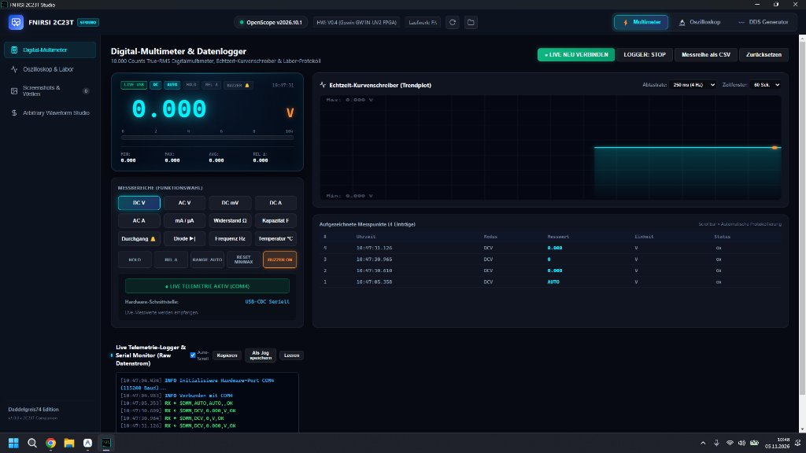
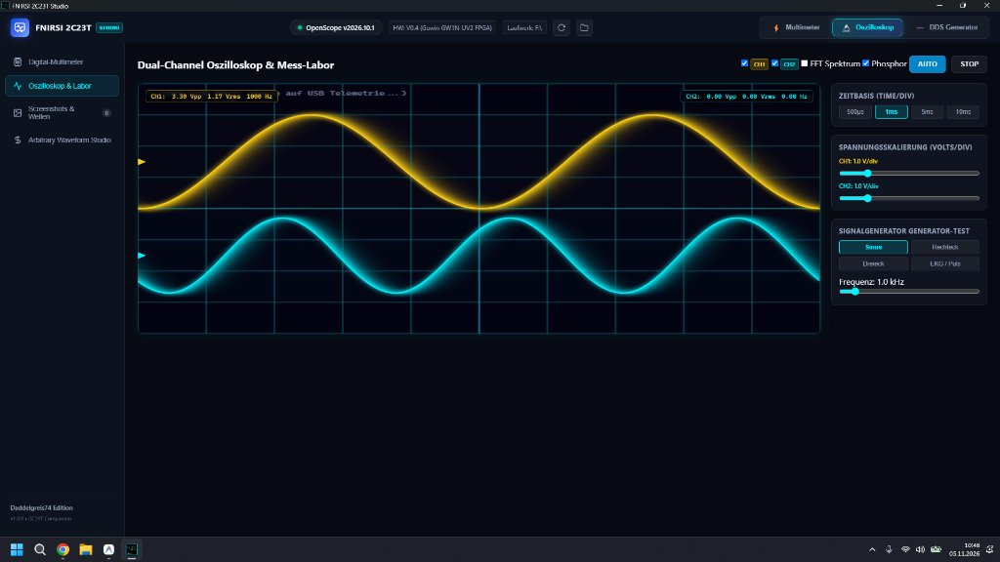
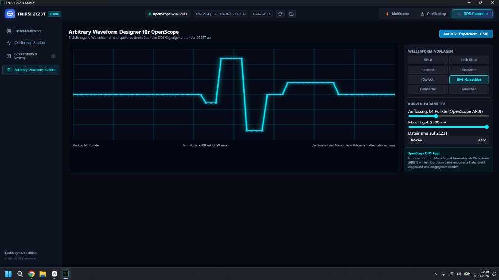

# FNIRSI 2C23T Studio ⚡🔬

> **Professional Windows Desktop Studio, Companion & Control Suite for the FNIRSI 2C23T Handheld 3-in-1 Digital Oscilloscope, Multimeter & DDS Function Generator.**

[](#)
[](LICENSE)
[](https://github.com/Daddelgreis74/fnirsi-2c23t-studio/releases)

---

## 📸 Screenshots & Vorschau

| Digital-Multimeter & Datenlogger | Dual-Channel Oszilloskop & Live-Labor |
|:---:|:---:|
|  |  |

| Arbitrary DDS Waveform Designer |
|:---:|
|  |

---

## 🌟 Features

* **⚡ 10.000 Counts Digital-Multimeter & Datenlogger (DMM Studio):**
  * Großes Digitaldisplay im OLED-Stil mit 12 umschaltbaren Messbereichen (DC V, AC V True-RMS, DC mV, DC A, AC A, mA/µA, Widerstand Ω, Kapazität F, Durchgang 🔔, Diodentest ▶|, Frequenz Hz, Temperatur °C).
  * Dynamischer Analog-Bargraph mit Skala und Reaktions-Farbverlauf.
  * Akustischer Durchgangsprüfer (Piezo-Buzzer) direkt über den PC.
  * Kontinuierlicher Echtzeit-Kurvenschreiber (Trendplot) mit automatischer Skalierung, Min/Max/Avg und einstellbarer Abtastrate (100 ms bis 2 s).
  * 1-Klick CSV-Export der Messreihe für Excel und Berichte.
* **🔬 Dual-Channel 60 FPS Oszilloskop-Labor:**
  * Reale Hardware-Live-Telemetrie über USB-CDC (CH1 Gelb oben, CH2 Cyan/Blau unten) mit Hardware-Ground-Markern.
  * Time/Div-Skalierung (500µs – 10ms) und Volts/Div-Regler.
  * Live FFT-Spektrumanalysator & Phosphor-Nachleuchteffekt.
  * Automatische Messwerte ($V_{pp}$, $V_{rms}$, Frequenz) synchron zum physischen Gerät.
* **⚡ Arbitrary Waveform Studio (OpenScope ARBT Designer):**
  * Interaktiver Kurveneditor: Freihand-Zeichnen mit der Maus oder mathematische Vorlagen (Sinus, Rechteck, Dreieck, Sägezahn, EKG-Puls, Rauschen).
  * 1-Klick-Export direkt als `.CSV` auf den 2C23T für den DDS-Signalgenerator.
* **📸 Live Screenshot- & Aufnahmen-Archiv:**
  * Automatische Erkennung aller mit der `SAVE`-Taste des 2C23T aufgenommenen Screenshots (`.BMP`).
  * Detailansicht, Zoom und 1-Klick-Export nach PNG.

---

## 🚀 Installation & Downloads

Download the latest version from [GitHub Releases](https://github.com/Daddelgreis74/fnirsi-2c23t-studio/releases):

* **Installer (NSIS):** `FNIRSI 2C23T Studio Setup 1.0.1.exe` (Desktop Icon & Start Menu Integration)
* **Portable:** `FNIRSI-2C23T-Studio-Portable-1.0.1.exe` (Single self-contained `.exe`)

---

## 🛠️ Development & Building

```bash
# Clone the repository
git clone https://github.com/Daddelgreis74/fnirsi-2c23t-studio.git
cd fnirsi-2c23t-studio

# Install dependencies
npm install

# Start development preview
npm start

# Build Windows Installer and Portable executable
npm run dist
```

---

## 📜 License

MIT License - Developed by **Daddelgreis74** (2026).
